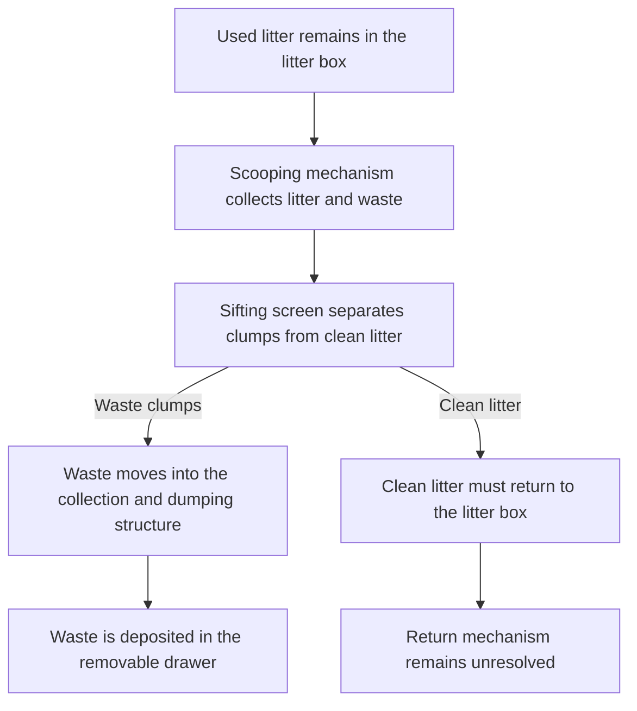

# Automatic Litter Box — CAD Concept

This is an independently developed CAD project for an automatic litter box. I completed the entire concept, dimensional planning, part modeling, assembly relationships, mechanical-motion design, and CAD animation independently.

The design combines an automated scooping mechanism with litter sifting, waste collection, and dumping structures. I modeled the individual components and assembled them into a complete mechanical system, then created a motion animation to demonstrate the intended sequence and interaction between the mechanisms.

The project ultimately remained at the CAD stage rather than becoming a complete physical prototype. The sifting screen contains fine features that could not be reproduced reliably with the available 3D printer. Printing the screen could result in blocked openings, deformation, or insufficient structural strength. Fabricating the design at its intended dimensions would also produce a large assembly requiring substantial printing time and material.

More importantly, although the current design demonstrates scooping and sifting, it does not yet provide a reliable method for returning the cleaned litter evenly to the litter box after separation. Without this return mechanism, the system cannot complete a full operating cycle.

Rather than fabricate an incomplete version or oversimplify the essential mechanisms merely to create a physical model, I preserved the complete CAD design and animation as a record of the current mechanical concept. A compact, manufacturable litter-return mechanism remains the primary challenge for future development.

## Intended Operating Flow

## Project Status

- Complete independent CAD model and assembly
- Downloadable 25-instance STEP assembly with 54 mate features
- Complete mechanical-motion animation
- Scooping, sifting, waste-collection, and dumping mechanisms designed
- Physical fabrication not completed because of printing-resolution, scale, and material constraints
- Clean-litter return mechanism remains unresolved
- No automation control code has been developed

## Project Media

### CAD Motion Animation

<video src="media/cad_motion_animation.mp4" controls width="620"></video>

- [Download the complete 25-instance STEP assembly with 54 mate features](cad/automatic_litter_box_assembly.step)
